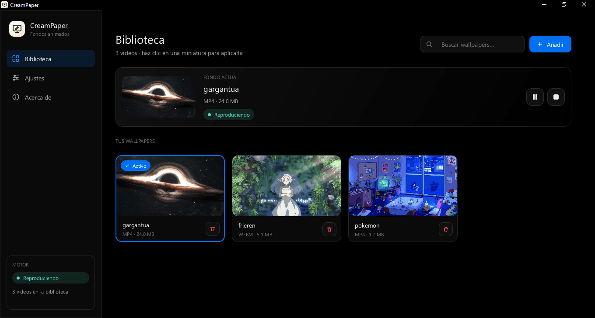
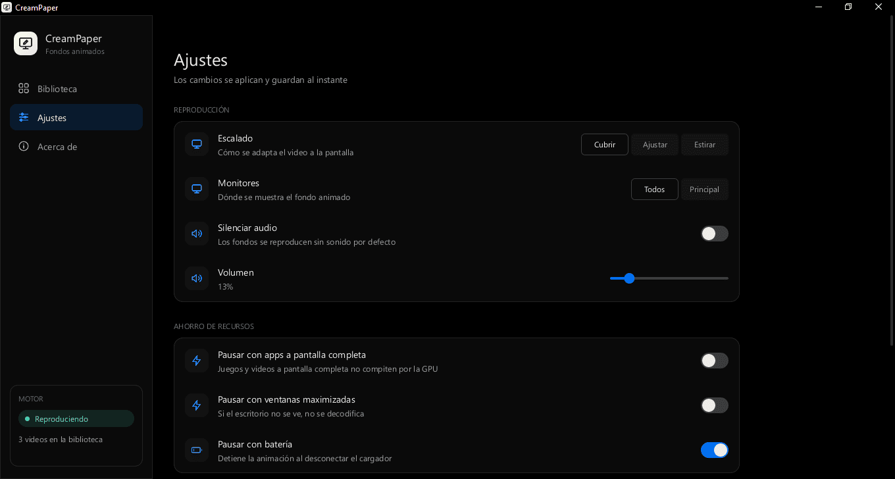
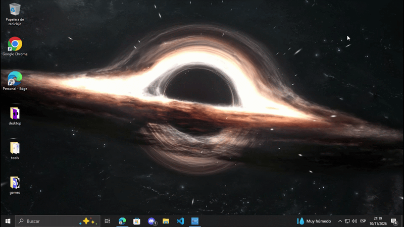

<div align="center">

<h1>🎞️ CreamPaper</h1>

Animated wallpaper manager for Windows, designed to play videos behind your desktop icons with minimal resource usage.

[](https://www.rust-lang.org/)
[](https://www.microsoft.com/windows)
[](https://crates.io/crates/creamui)

</div>

## Overview

CreamPaper is a Windows desktop application that lets you use videos as an animated wallpaper. It combines an easy-to-use wallpaper library with a lightweight playback engine that takes advantage of the system's native hardware decoding.

The interface only redraws when a `Signal` changes, and the window can be closed to the system tray while the wallpaper keeps running.

## Key Features

- Video playback (MP4, M4V, MOV, WMV, AVI, MKV, WebM) **behind the desktop icons**.
- Library with thumbnails, search, drag and drop, and one-click apply.
- Cover / Fit / Stretch scaling, all monitors or just the primary one, volume and mute.
- Automatic pause with fullscreen apps, maximized windows, or battery power.
- System tray, close to tray, start with Windows, and restore the last wallpaper.
- Low resource usage: hardware decoding, an engine that sleeps when idle, and an optimized binary.

## Screenshots

<table>
  <tr>
    <td align="center" width="50%">
      
      <br /><br />
      <b>Library</b>
      <br />
      <sub>Thumbnails, search, and one-click apply.</sub>
    </td>
    <td align="center" width="50%">
      
      <br /><br />
      <b>Settings</b>
      <br />
      <sub>Scaling, monitors, volume, and background behavior.</sub>
    </td>
  </tr>
  <tr>
    <td align="center" colspan="2">
      
      <br /><br />
      <b>Result on the desktop</b>
      <br />
      <sub>Video playing behind the icons.</sub>
    </td>
  </tr>
</table>
## Architecture

CreamPaper is organized into four small, well-separated layers:

- `src/main.rs` is the application entry point.
- `src/app/` handles startup, the window, and global state (`AppState`: signals and actions such as apply, pause, or change settings).
- `src/model/` contains pure data and persistence, with no UI or Win32 code.
- `src/engine/` is the playback engine, with its own thread and command/event communication.
- `src/ui/` builds the entire interface with `jsx!`: layout, theme, icons, components, and pages.

### How it works

The UI calls `AppState` methods, which update the signals, persist the changes, and send an `EngineCommand`. The engine replies with `EngineEvent`s that reach the UI thread through `AppHandle::spawn_stream`.

### Low resource usage

| Component  | How it stays lightweight                                                                                                     |
| ---------- | ---------------------------------------------------------------------------------------------------------------------------- |
| Decoding   | Media Foundation (MFPlay + EVR): native Windows hardware decoding, with no embedded browser or custom renderer.              |
| Engine     | Dedicated thread that sleeps on `GetMessageW`. It only wakes up for commands, video events, or a 1.5 s timer for auto-pause. |
| Auto-pause | Per monitor: if a monitor's desktop isn't visible (fullscreen / maximized window), its video is paused and stops decoding.   |
| Interface  | CreamUI only redraws when a `Signal` changes. The window can be closed to the tray while the wallpaper stays active.         |
| Thumbnails | Provided by Explorer's thumbnail cache (`IShellItemImageFactory`) on a background thread.                                    |
| Binary     | `lto = "fat"`, `codegen-units = 1`, `strip = true`.                                                                          |

## Project Structure

```text
src/
├── main.rs              # entry point
├── app/                 # startup, window, and global state
│   ├── mod.rs           # AppBuilder, window, lifecycle
│   └── state.rs         # AppState: signals + actions (apply, pause, settings...)
├── model/               # pure data and persistence (no UI or Win32)
│   ├── settings.rs
│   ├── wallpaper.rs
│   └── storage.rs       # JSON with atomic writes
├── engine/              # playback engine (own thread, commands/events)
│   ├── mod.rs           # EngineCommand / EngineEvent / EngineHandle
│   ├── windows.rs       # WorkerW + MFPlay + tray + auto-pause + autostart
│   └── stub.rs          # simulation for other platforms
└── ui/                  # everything with jsx!
    ├── mod.rs           # root layout
    ├── theme.rs         # palette, CreamUI Theme, and layout helpers
    ├── icons.rs         # SVG icons rasterized once and cached
    ├── components/      # one #[component] per file
    │   ├── sidebar.rs, nav_item.rs, page_header.rs, search_box.rs
    │   ├── now_playing.rs, wallpaper_card.rs, thumbnail.rs, status_badge.rs
    │   ├── settings_section.rs, setting_row.rs, controls.rs, buttons.rs
    │   └── empty_state.rs, notice_banner.rs, scroll.rs
    └── pages/
        ├── library.rs
        ├── settings.rs
        └── about.rs
```

## Requirements

- Windows (the animated wallpaper is only rendered on this system)
- Stable Rust with the MSVC toolchain (`rustup default stable-x86_64-pc-windows-msvc`)
- Visual Studio Build Tools

> On Linux the app compiles and the interface is fully usable, with a simulated engine, for UI development. The animated wallpaper is only rendered on Windows.

## Getting Started

### Build and run

```powershell
cargo run --release
```

The executable is placed at `target\release\creampaper.exe`.

### Start in the background

```powershell
creampaper.exe --background
```

Starts hidden in the tray. This is the option used by "Start with Windows".

### Configuration

Settings are stored at `%APPDATA%\CreamPaper\config.json`.

## Usage

| Action                           | Result                                                 |
| -------------------------------- | ------------------------------------------------------ |
| Drag and drop a video            | Add it to the library                                  |
| Click a wallpaper in the library | Apply it as the wallpaper                              |
| Search box                       | Filter the library                                     |
| Scaling settings                 | Choose Cover, Fit, or Stretch                          |
| Monitor settings                 | Apply to all monitors or just the primary one          |
| Volume / mute                    | Control the wallpaper's audio                          |
| Close the window                 | Send the app to the tray and keep the wallpaper active |
| System tray                      | Reopen the window or manage the app in the background  |
